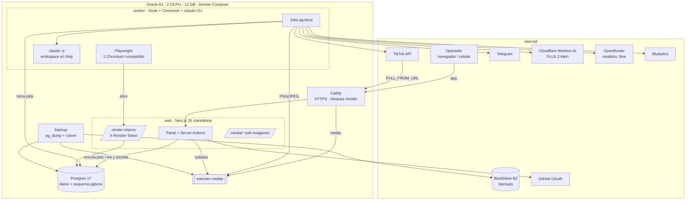
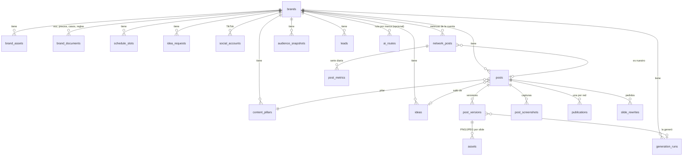

# Auditoría técnica — RAdev Social (2026-11-20)

Diagnóstico del repositorio tal como está en `main` (`7d114e8`), como base para evolucionar hacia **RAdev Studio** con un módulo nuevo, **Video Studio**. Este documento describe; las propuestas están en `docs/EVOLUTION-PLAN.md`.

**Alcance y método.** Se leyeron `CLAUDE.md`, `docs/ARCHITECTURE.md`, `docs/PRD.md`, `docs/ROADMAP.md`, `docs/PROGRESS.md`, los ADR de infraestructura y media, `compose.yaml`, `compose.prod.yaml`, `Dockerfile`, `infra/caddy/Caddyfile`, el schema de Drizzle, el arranque del worker, los tipos de `packages/ai` y `packages/publishers`, y la estructura de todos los paquetes. No se ejecutó código ni se tocó la base: las medidas de recursos salen de la documentación y del código, no de un perfilado.

---

## Resumen ejecutivo

- **Es un monolito modular sano**: 7 paquetes con límites claros, reglas de dependencia respetadas, dominio puro testeado y una sola base que además es la cola de trabajos (pg-boss). Es una buena base para sumar un segundo módulo.
- **Todo el dominio gira alrededor del `post` de carrusel**: la máquina de estados, `post_versions`, `assets`, `publications`, `generation_runs` y las métricas cuelgan de `posts`. Video Studio necesita su propia entidad; generalizar `posts` sería la parte más cara y riesgosa.
- **Lo más reutilizable**: auth, marcas y sus documentos, el ruteo de IA con respaldo y validación Zod, pg-boss y el patrón de jobs idempotentes, media en disco, Telegram, cuentas sociales con tokens cifrados, el render con Chromium y **los componentes React de `packages/slides`** (Remotion también es React).
- **Lo que no está preparado para video**: la media solo acepta y sirve imágenes y se lee entera a memoria (no hay streaming ni `Range`); las subidas pasan por Server Actions con tope de ~6 MB; el backup copia `media/` entera a la capa gratuita de B2 (10 GB); el servidor tiene 2 OCPU, que alcanzan para un carrusel pero no para render de video largo; no hay soporte de idiomas: interfaz y contenido asumen español rioplatense.
- **Choque con la regla 13 (costo cero)**: ElevenLabs y, según el uso, Remotion y la YouTube Data API tienen condiciones que hay que decidir antes de diseñar (ver §13 y `EVOLUTION-PLAN.md` §8).

---

## 1. Arquitectura general del monorepo

**Estilo:** monolito modular con dos procesos (`web` y `worker`) sobre una sola base Postgres, que es a la vez la fuente de verdad y el canal de comunicación. La web encola y el worker ejecuta. No hay HTTP de la web al worker, ni Redis, ni microservicios.

**Tooling:** pnpm 12 (workspaces) y Turborepo 2.11, TypeScript 6 en modo strict, Biome, Vitest 5 (más de 900 tests según `PROGRESS.md`), Node 24 (`.nvmrc`). pnpm bloquea los scripts de instalación y las versiones muy nuevas; las excepciones están en `pnpm-workspace.yaml`.

**Tamaño (líneas TS/TSX, sin `node_modules`):**

| Paquete | Archivos | Líneas | Tests |
|---|---:|---:|---:|
| `apps/web` | — | ~16.400 | (lógica testeada en paquetes) |
| `apps/worker` | 36 | ~6.000 | 14 archivos |
| `packages/slides` | 123 | ~16.000 | 26 |
| `packages/db` | 43 | ~5.900 | 6 |
| `packages/core` | 60 | ~5.300 | 27 |
| `packages/ai` | 24 | ~3.000 | 9 |
| `packages/publishers` | 11 | ~1.300 | 4 |

**Reglas de dependencia** (CLAUDE.md, regla 1): `core` no depende de nada del repo; `web` y `worker` dependen de los paquetes, nunca entre sí. En los `package.json` se cumple: el worker usa `ai`, `core`, `db`, `publishers` y `slides`; la web usa `core`, `db`, `publishers` y `slides` (no `ai`, coherente con la regla 5).

### Diagrama de la arquitectura actual

---

## 2. Aplicaciones, paquetes y responsabilidades

| Unidad | Responsabilidad | Observaciones |
|---|---|---|
| `apps/web` | Panel (marcas, posts, editor, revisión, calendario, ideas, métricas, ajustes, cola de trabajos), login, callback de TikTok, `/render` interno, `/media` público | Server Components y Server Actions validadas con Zod. Encola jobs con `pg-boss` directamente. Nunca ejecuta IA ni Playwright. |
| `apps/worker` | 15 jobs (generación, arte, render, ideas, rewrite, datos, publicación, confirmación de TikTok, tokens, métricas, llenado de slots, avisos) | Un solo proceso, todas las colas con `batchSize: 1`. Un Chromium compartido. Logs JSON. |
| `packages/core` | Dominio puro: máquina de estados de posts, tareas y ruteo de IA, límites, arte, marcas (pilares, contacto, documentos), scheduling (slots, zonas, llenado, publicación), métricas, leads, notificaciones, constantes de jobs (`JOBS`, `QUEUE_OPTIONS`) | Sin I/O. Es el lugar natural para la máquina de estados de videos. |
| `packages/db` | Schema Drizzle (23 tablas + 4 de Better Auth), 28 migraciones (`0000`–`0027`), queries por dominio, seed de marcas y rutas de IA, cifrado de tokens, acceso a `MEDIA_DIR` | `media.ts` valida rutas y escribe de forma atómica (tmp + rename). |
| `packages/slides` | Contenido de carruseles (schemas Zod, límites, énfasis, composiciones, capturas), `SlideFrame`, presets `bold`, `soft` y `studio` (16 looks), fuentes auto-hospedadas, íconos, QA del render, guía para la IA | El paquete más grande. Componentes React puros: **reutilizables dentro de Remotion**. |
| `packages/ai` | `AIProvider` (claude-code, openrouter, fake), router con respaldo, workspace aislado, instrucciones de marca, inline de archivos, schemas de ideas, imágenes (Cloudflare) | Contrato genérico: tarea + archivos + schema Zod → resultado validado. No sabe nada de carruseles salvo los schemas que recibe. |
| `packages/publishers` | `PublisherAdapter`; `manual`; `tiktok` (OAuth, posting, display) | La interfaz `PublishInput` es mínima (`postId`, `publicCode`): pensada para posts. |
| `infra/` | Caddy, scripts del servidor (hardening, setup, deploy, restore, mudanza), backup | Bien documentado en `infra/server/README.md`. |
| `seeds/brands/` | Voz, precios, casos y assets iniciales de RAdev y Lumus | Solo se cargan si la marca falta. |

---

## 3. Base de datos, tablas, relaciones y migraciones

**Motor:** Postgres 17 en Docker (volumen `postgres-data`, puerto `127.0.0.1:5433` en local, sin puerto en producción). **ORM:** Drizzle, con migraciones SQL versionadas (`packages/db/migrations`, 28 hasta `0027_post_screenshots`). El servicio `migrate` las aplica en cada `docker compose up`, junto con el seed.

**Mapa de relaciones (simplificado):**

**Tablas sueltas:** `settings` (clave/valor global), `notifications` (clave única, anti-duplicado), `data_snapshots` (Bluelytics). Además, las 4 de Better Auth (`user`, `session`, `account`, `verification`) y el esquema `pgboss`.

**Patrones a conservar:**
- Enumerados como `text` con `CHECK (... in (...))` generados desde las constantes de `core`: un valor nuevo implica una migración que amplía el CHECK (ya se hizo en la `0017`).
- `uniqueIndex` para la idempotencia (una publicación por post y red, un `post_metrics` por día y fuente, una hora por marca).
- Timestamps `timestamptz` en UTC (regla 11); `brands.timezone` para mostrar.
- Rutas de archivo relativas a `MEDIA_DIR`, nunca binarios en la base.
- `onDelete: restrict` en lo que tiene historial (las marcas se archivan, no se borran).

**Acoplamientos que importan para video:**
- `publications.post_id`, `post_metrics` → `network_posts.post_id` → `posts`, `generation_runs.post_id`, `slide_rewrites`: todo referencia `posts`.
- `assets` está atado a `post_version_id`, `slide_index` y `format` (enum de render, hoy solo `4x5`).
- `NETWORKS` y `SOCIAL_NETWORKS` solo traen `manual` y `tiktok`.
- `network_posts.kind` ya admite `video`: es la única tabla que ya contempla video.

**Inconsistencias de documentación detectadas** (no del código): `ARCHITECTURE.md` §10 tiene dos filas `leads` con columnas distintas; el comentario de `packages/publishers/src/types.ts` dice que `checkStatus` y `refreshToken` "llegan con TikTok", pero la interfaz sigue sin ellos; el PRD (§8) dice "nunca fotos ni generación de imágenes con IA" y "video de cualquier tipo" fuera de la v1, pero los ADR 0016 y 0025 ya sumaron imágenes. Video Studio va a necesitar actualizar el PRD con un ADR.

---

## 4. Sistema de workers y pg-boss

- **pg-boss 12** sobre la misma base, esquema `pgboss`. La web y el worker usan la misma versión fijada.
- **Un solo proceso worker** registra 15 colas. Todas con `batchSize: 1`: una generación por vez (comparte la suscripción de Claude con el operador), un render por vez (Chromium es lo más pesado) y un arte por vez.
- **Idempotencia** por `singletonKey` derivada del objetivo (`publish:<post>`, `art:<versión>`, `tiktok:<post>`...) y por chequeos de estado al empezar (`isPublishJobCurrent`, "solo si sigue `publishing`").
- **Reintentos y expiración** en `QUEUE_OPTIONS` (`packages/core/src/jobs.ts`), por ejemplo: `carousel.generate` 2 reintentos y vence a los 20 min; `art.generate` 0 reintentos y 8 min; `tiktok.publish` 4 reintentos y 10 min.
- **Crons** (`boss.schedule`): `slots.fill` cada 15 min, `tiktok.confirm` cada 5, `metrics.sync` cada 4 h, `data.refresh` diario, `tokens.refresh` diario. Con `missed: "once"` se recupera una corrida perdida.
- **Apagado ordenado**: espera hasta 30 s a los jobs en curso (`stop_grace_period: 40s` en Compose).
- **Vista de jobs** en el panel (`/settings/jobs`), que lee `pgboss.job` con consultas de solo lectura.
- **Límite de diseño para video:** un job que tarde decenas de minutos (render de un video largo) en el **mismo proceso** que los demás no bloquea otras colas (pg-boss trabaja cada cola por separado), pero compite por CPU con el render de carruseles y con la web en una máquina de 2 OCPU. Y si el proceso se reinicia (deploy), el job en curso se pierde y se reintenta desde cero.

---

## 5. Integraciones de IA y sistema de prompts

- **Contrato** (`packages/ai/src/types.ts`): `GenerationTask<T>` = tarea, marca, prompt, archivos de contexto, **schema Zod**, modelo, imágenes opcionales, herramientas, turnos, timeout y `signal`. `GenerationResult<T>` = datos validados o error tipado (`validation`, `rate_limited`, `provider_error`) más el uso.
- **Proveedores**: `claude-code` (`claude -p` con la suscripción, en `/tmp/radev-social/runs/<id>/`, fuera del repo, con `HOME` aislado y sin secretos en el entorno; modo liviano de ~1.000 tokens base) y `openrouter` (solo modelos `:free`, salvo que se habilite `allowPaidModels`). `fake` para tests.
- **Router**: principal → respaldo ante `rate_limited` o `provider_error`, nunca ante `validation`. Rutas en `ai_routes`, editables desde el panel, con override por marca.
- **Prompts**: la voz, las reglas, los precios y los casos de la marca se arman desde la base (`brand-instructions.ts`) y van como prompt de sistema. La guía de cada tarea vive en código (`packages/slides/src/content/generation.ts`: guía de slides, composiciones y arte). El contexto viaja como archivos (`task.json`, `recent-posts.json`, `data.json`...) incorporados al prompt (`inline.ts`).
- **Tareas** (`core/ai/tasks.ts`): `carousel.generate`, `slide.rewrite`, `ideas.generate`, `ideas.research`, `caption.variants`, `metrics.extract`. Cada tarea nueva amplía el CHECK de `ai_routes` y `generation_runs` con una migración.
- **Registro**: cada intento queda en `generation_runs` (proveedor, modelo, tokens, duración, turnos, error).
- **Límites**: topes diarios y mensuales por marca (solo cuentan carruseles), ventana nocturna de generación automática, backoff ante límites (15 → 240 min).
- **Imágenes**: Cloudflare Workers AI (`flux-2-klein-4b`, 1024×1024, 15–36 s, ~105 neuronas por imagen sobre 10.000 diarias gratis), tope propio `ART_DAILY_CAP = 60`.
- **Regla 9 aplicada en Zod**: las cifras solo pueden venir de `data.json` o de los documentos de la marca (rangos de precios, `figures`).

**Para video:** el contrato sirve tal cual para guiones (schema Zod del guion y de las escenas). El tamaño de salida es la variable nueva: un guion de 8–12 minutos con escenas puede pasar los límites de salida de los modelos gratuitos y el `timeoutMs` de 5 min.

---

## 6. Generación y renderizado de imágenes

1. La IA escribe el carrusel (JSON `Carousel`) y, si el look lleva imagen, `art.cover`, `art.cta` y opcionalmente `art.middle` (descripciones en inglés).
2. `art.generate` arma el prompt (`artPrompt`, `scenePrompt`), pide a Cloudflare, mide el brillo de los bordes en Chromium, reintenta una vez si el fondo salió mal y guarda en `media/<marca>/<post>/<versión>/art/`.
3. `carousel.render` abre `http://web:3000/render/<versión>/<slide>` con `X-Render-Token`, espera `window.__renderReady`, corre el QA en la página (desbordes, zona segura, fuentes) y guarda PNG y JPEG (1080×1350) en `media/<marca>/<post>/<versión>/4x5/`.
4. Si el QA falla en una versión de IA: regeneración automática (máximo 2).

**Puntos fuertes:** render determinista (semilla por post), QA automático, el mismo componente en la vista previa del panel y en el render.

**Para video:** el render actual es **por cuadro fijo vía la web**. Un video necesita miles de cuadros por segundo de contenido: no conviene hacerlo con páginas de Next.js. Remotion trae su propio empaquetado y su propio Chrome headless, y puede importar los componentes de `packages/slides` directamente (sin pasar por la web).

---

## 7. Storage y gestión de archivos

- **Dónde**: `MEDIA_DIR` (`./media` en local, montada en `/data/media` en los contenedores). La base guarda rutas relativas imposibles de adivinar (UUID).
- **Escritura**: atómica (`writeMediaFile`: tmp + rename), con validación de rutas (`resolveMediaPath` rechaza `..` y rutas absolutas).
- **Servido**: panel → `/media/[...path]` de Next.js; público → `media.gestorlumus.site`, servido directo por Caddy.
- **Restricciones para video:**
  - La ruta de Next solo acepta `png`, `jpg`, `webp` y `svg`, **lee el archivo entero a memoria** (`readMediaFile`) y no maneja `Range`: un MP4 de 200 MB tumbaría la memoria de la web y el `<video>` del navegador no podría adelantar.
  - Caddy (`media.`) solo deja pasar `png|jpe?g|webp|svg`.
  - Las subidas van por Server Actions (tope práctico de ~6 MB; las capturas se comprimen en el navegador para entrar). No sirve para clips, música o voces de referencia.
  - Uploads de marca: hasta 5 MB y solo imágenes.
- **Volumen actual**: `media/` local pesa 320 KB. En producción son PNG y JPEG de carruseles: chico. Con video, un Short de 60 s en 1080×1920 pesa unos 20–60 MB y un video de 10 min, 300 MB–1 GB más los intermedios (audio, escenas). Es un cambio de escala de 100× a 1000×.
- **Disco**: la instancia tiene 100 GB de arranque (ADR 0014; Always Free permite hasta 200 GB en total).

---

## 8. Autenticación y seguridad

- **Login**: Better Auth 1.7 con GitHub, lista blanca `ALLOWED_EMAILS` en `validateUserInfo`, tokens de GitHub cifrados (`encryptOAuthTokens`). Sesiones en Postgres.
- **Tokens de redes**: AES-256-GCM (`TOKEN_ENCRYPTION_KEY`), formato `v1.<iv|tag|cifrado>` con datos autenticados (red, cuenta, tipo); solo `queries/social-accounts.ts` los toca. La renovación bloquea la fila (`renewSocialAccountTokens`), así dos renovaciones a la vez no gastan el mismo refresh token.
- **OAuth de TikTok**: `state` aleatorio en una cookie httpOnly `SameSite=Lax` de 10 min, limitada a `/api/tiktok`.
- **Render interno**: `X-Render-Token` comparado en tiempo constante (digests SHA-256) y `/render` bloqueado en Caddy.
- **IA aislada**: `claude -p` fuera del repo, sin secretos en el entorno, sin MCP, hooks ni ajustes del usuario.
- **Servidor**: Postgres sin puertos, firewall 22/80/443, SSH con llave o contraseña y fail2ban (ADR 0019), actualizaciones automáticas, HSTS, `nosniff` y CSP `sandbox` en la media.
- **Secretos locales**: `.env`, `.env.bak` y `.env.local` existen en la raíz y están ignorados por git (verificado: no están versionados). Conviene borrar `.env.bak` si ya no hace falta.
- **Para video:** una cuenta de YouTube es una credencial de Google con alcance de subida a un canal. Entra en el mismo esquema (`social_accounts` cifrado). La clave de ElevenLabs sería un secreto más del worker, que nunca se pasa a `claude -p`.

---

## 9. Docker y configuración de infraestructura

- **Un `Dockerfile`, cinco destinos**: `migrate`, `web` (standalone de Next, ~391 MB), `worker` (Node + Chromium headless shell de Playwright + binario de Claude Code; ~400 MB más), `backup` (postgres:17 + rclone) y las etapas intermedias. Base `node:24-bookworm-slim`, multi-arquitectura (amd64/arm64).
- **Compose local**: `postgres`, `migrate` (corre y termina), `web` (`127.0.0.1:3000`) y `worker`. `./media` montada en los tres.
- **Compose de producción** (`compose.prod.yaml`, se suma al base): quita los puertos, agrega `caddy` (80/443, Let's Encrypt) y `backup`, rota los logs (3 × 10 MB) y define `restart: unless-stopped`.
- **Servidor**: Oracle Cloud A1.Flex, 2 OCPU / 12 GB, ARM, cuenta Pay As You Go usando solo recursos Always Free (ADR 0014), alerta de presupuesto en USD 1.
- **Deploy**: `infra/server/deploy.sh` (pull + build en el servidor). No hay registro de imágenes: el build ARM se hace en la misma máquina, que es la que corre producción.
- **Backup**: diario, `pg_dump` cifrado + `media/` con rclone a B2, retención de 14 días.

---

## 10. Consumo de recursos y procesos que pueden quedar inactivos

Estimaciones a partir del código (sin perfilar):

| Proceso | En reposo | En trabajo | Comentario |
|---|---|---|---|
| Postgres 17 | ~50–100 MB | sube con las consultas de métricas | Sin ajuste de memoria (valores por defecto del contenedor). |
| web (Next standalone) | ~150–250 MB | picos al renderizar páginas de `/render` y en subidas | Sirve `/media` desde memoria. |
| worker (Node) | ~150 MB | + Chromium | El Chromium se abre **la primera vez que se usa y queda abierto** (`render/browser.ts`): una vez que renderizó, ocupa ~200–400 MB para siempre, aunque no haya trabajo. |
| `claude -p` | 0 | ~200–400 MB por ejecución | Solo mientras corre; uno por vez. |
| Caddy | ~20–40 MB | — | |
| backup | ~10 MB (loop dormido) | pg_dump + rclone una vez por día | |

**Actividad de fondo:** pg-boss consulta su cola de forma periódica (unos segundos por cola) y mantiene un pool de conexiones; `tiktok.confirm` cada 5 min (sin borradores no llama a TikTok), `slots.fill` cada 15 min (sin hacer nada fuera de la ventana de generación), `metrics.sync` cada 4 h.

**Oportunidades (no urgentes con el uso actual):**
1. Cerrar Chromium después de N minutos sin renders. Hoy no hace falta (sobra RAM), pero pasa a importar si el mismo worker suma Remotion, que abre su propio Chrome.
2. Un worker de video **separado y apagable** (perfil de Compose) para que el render pesado no conviva con el panel.
3. `tiktok.confirm` podría quedar en pausa cuando no hay borradores, aunque el costo actual es casi nulo.
4. Límites de memoria y CPU en Compose (`mem_limit`, `cpus`), para que un render de video no ahogue a Postgres y a la web.

---

## 11. Calidad general y deuda

- **Fortalezas**: documentación excelente y al día (ARCHITECTURE con detalles de verdad, 26 ADR, PROGRESS como bitácora), dominio puro con tests, idempotencia pensada de verdad, seguridad cuidada para un proyecto personal, costo cero logrado en producción.
- **Deuda menor**: las inconsistencias de documentación de §3; `PublisherAdapter` desactualizado respecto de lo que hace TikTok (la lógica real vive en el job del worker); `posts_per_day_target` sin uso; el nombre `radev-social` está en el compose, en las imágenes, en `/tmp/radev-social`, en los scripts del servidor y en el repo.
- **Riesgo estructural principal para Video Studio**: casi todo lo transversal (publicaciones, métricas, ejecuciones de IA) referencia `posts` directamente. Decidir cómo se modela la "pieza de contenido" es la primera decisión de la evolución (ver `EVOLUTION-PLAN.md` §4 y §8).

---

## 12. Lo que no se verificó

- Consumo real de memoria y CPU en el servidor (habría que mirar `docker stats` en producción).
- Si Remotion corre bien en ARM64 dentro de `bookworm-slim` junto al Chromium de Playwright.
- Las cuotas y condiciones vigentes de YouTube Data API, YouTube Analytics API, ElevenLabs y Remotion. Las cifras de `EVOLUTION-PLAN.md` hay que confirmarlas en la documentación oficial antes de decidir.
- Todos los componentes de la web, uno por uno: se revisó la estructura y las piezas críticas (auth, media, render), no cada pantalla.

## 13. Conflictos con las reglas del proyecto

| Regla | Conflicto con Video Studio |
|---|---|
| 13 (costo cero) | ElevenLabs: el plan gratuito tiene pocos minutos por mes y no permite uso comercial (a confirmar). Remotion: gratis para personas y empresas chicas, con licencia paga por encima de cierto tamaño (a confirmar). Storage: el backup de video supera rápido los 10 GB gratis de B2. |
| 5 (la web no ejecuta IA ni Playwright) | El render de Remotion, TTS y FFmpeg tienen que vivir en un worker. La vista previa en el panel con `@remotion/player` corre en el navegador del operador, no en el servidor: no viola la regla. |
| 3 (nada se publica sin `approved`) | Hay que replicarla con su test en la máquina de estados de videos. |
| 9 (la IA no inventa números) | Aplica igual a los guiones: cifras desde datos provistos. |
| 12 (multi-arquitectura) | FFmpeg, Remotion y cualquier TTS local tienen que tener binarios arm64. |
| PRD §8 | "Video de cualquier tipo" está fuera de la v1: hace falta un ADR y actualizar el PRD. |
