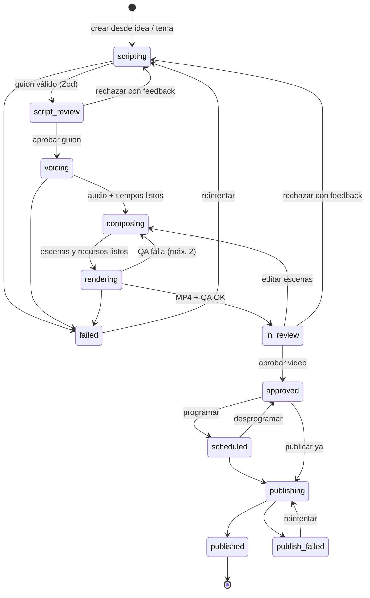

# Plan de evolución — de RAdev Social a RAdev Studio

> **⚠ Documento histórico (2026-11-25).** Es el plan de evolución propuesto el 2026-11-20 (nunca aprobado tal cual). Quedó reemplazado en lo central por V0, `RADEV-STUDIO-REVISION.md` y ADR 0029: formato documental, oficinas, dos formatos por video, un `video-worker` aparte que corre en la notebook y descarga del paquete (`short/` y `normal/`). Lo vigente de V1 está en `docs/RADEV-STUDIO-REVISION.md` §7, `docs/decisions/0029-video-documental-y-oficinas.md` y `docs/ARCHITECTURE.md` §14.

**Estado:** propuesta para revisar (2026-11-20). Nada de esto está implementado ni aprobado. Se apoya en el diagnóstico de `docs/AUDIT.md`.

**Objetivo.** Sumar un módulo **Video Studio** que produce YouTube Shorts y videos largos con IA (guion → voz → escenas → render → revisión → publicación → métricas), en español y en inglés, sin romper **Social Studio** (lo que hoy es RAdev Social). Los dos módulos son independientes y comparten infraestructura y servicios.

---

## 1. Principios

1. **Mismo estilo, segundo módulo.** Monolito modular: una base, pg-boss como cola y paquetes con límites claros. Nada de microservicios, Redis ni colas externas.
2. **Social Studio no se toca para que entre Video.** Las tablas, la máquina de estados y los jobs de posts quedan como están. Video tiene sus propias entidades; lo compartido se extrae solo cuando dos módulos lo usan de verdad.
3. **Las reglas del proyecto valen igual**: estados solo por máquina de estados, nada se publica sin `approved` (con test), salida de IA validada con Zod, la IA no inventa cifras, jobs idempotentes, marcas como datos, multi-arquitectura y costo cero salvo decisión explícita.
4. **El trabajo pesado (TTS, Remotion, FFmpeg) va en un worker propio y apagable**, nunca en la web ni mezclado con el worker social.
5. **Dos puertas de aprobación en video**: el guion (barato de rehacer) y el video final (caro). Así no se gastan voz ni render en un guion que se iba a rechazar.

---

## 2. Arquitectura objetivo

```mermaid
flowchart TB
  subgraph Ext["Servicios externos"]
    CLAUDE[claude -p<br/>suscripción]
    OR[OpenRouter :free]
    CFAI[Cloudflare Workers AI<br/>imágenes]
    EL[ElevenLabs<br/>TTS]
    YT[YouTube Data API<br/>+ Analytics API]
    TT[TikTok API]
    TG[Telegram]
    B2[(B2 backups)]
  end

  subgraph Server["Servidor · Docker Compose"]
    CADDY[Caddy]
    subgraph WEB["web · Next.js (un solo panel)"]
      SHELL[Shell común<br/>auth · marcas · ajustes · jobs]
      SOC[Social Studio<br/>posts · calendario · revisión]
      VID[Video Studio<br/>proyectos · guion · escenas<br/>revisión con Remotion Player]
      MEDIA[/media con Range<br/>imágenes · audio · video/]
    end
    subgraph WS["worker (social) · sin cambios"]
      SJ[carousel.* · art.* · tiktok.*<br/>slots.fill · metrics.sync]
      CHR[Chromium Playwright]
    end
    subgraph WV["video-worker · nuevo · apagable"]
      VJ[script.generate · voice.synthesize<br/>scenes.prepare · video.render<br/>video.publish · youtube.sync]
      REM[Remotion renderer<br/>Chrome headless]
      FF[FFmpeg / ffprobe]
    end
    PG[(Postgres<br/>datos + pgboss)]
    VOL[[media/]]
  end

  CADDY --> WEB
  SHELL & SOC & VID --> PG
  SJ --> PG
  VJ --> PG
  SJ --> CLAUDE & OR & CFAI & TT & TG
  VJ --> CLAUDE & OR & CFAI & EL & YT & TG
  CHR -->|/render| WEB
  REM -.->|importa componentes| SLIDES
  VJ --> VOL
  SJ --> VOL
  MEDIA --> VOL

  subgraph Pk["Paquetes compartidos"]
    CORE[core<br/>posts/ + videos/ + compartido]
    DB[db]
    AI[ai<br/>LLM · imágenes · TTS]
    SLIDES[slides<br/>looks · tokens · fuentes]
    VIDEO[video · nuevo<br/>schemas + composiciones Remotion]
    PUB[publishers<br/>manual · tiktok · youtube]
  end
```



**Qué comparten los dos módulos:** login y lista blanca, marcas (identidad, documentos, pilares, assets), banco de ideas, ruteo y registro de IA, Cloudflare para imágenes, Telegram, cuentas sociales cifradas, media en disco, pg-boss, Postgres, Caddy, backup, deploy, logs y vista de jobs.

**Qué es propio de cada uno:** su entidad de contenido y su máquina de estados, sus jobs, su motor de render (Playwright por slide contra Remotion por cuadro), sus publicadores y sus pantallas.

### Monorepo propuesto

```
apps/
  web/                 un panel: secciones Social y Video sobre el mismo shell
  worker/              Social Studio (sin cambios funcionales)
  video-worker/        NUEVO: jobs de video (guion, voz, escenas, render, publicación, métricas)
packages/
  core/                + videos/ (máquina de estados, reglas de duración y escenas, scheduling)
                       + shared/ si hace falta (idiomas, pieza de contenido)
  db/                  + tablas de video (§4)
  ai/                  + tts/ (ElevenLabs y alternativa), + tareas de guion
  slides/              sin cambios de contrato; sus componentes se reusan en video
  video/               NUEVO: schemas Zod (guion, escenas, VideoSpec), composiciones Remotion
  publishers/          + youtube/ (OAuth, subida reanudable, estado)
```

`video-worker` es una app nueva porque la regla 1 prohíbe que las apps dependan entre sí y porque necesita otra imagen (FFmpeg y Chrome de Remotion) y otro ciclo de vida (se puede apagar). Su arranque sigue el patrón de `apps/worker/src/index.ts`.

---

## 3. Flujo de un video



Invariantes con test (igual que en posts): no se llega a `scheduled`, `publishing` ni `published` sin pasar por `approved`; editar algo aprobado lo devuelve a revisión; desprogramar cancela el job de publicación.

---

## 4. Modelo de datos propuesto

**Decisión de fondo (D1, §8): entidad propia `videos`** en lugar de generalizar `posts`. Generalizar obligaría a migrar `posts`, `publications`, `generation_runs`, `post_metrics` y `network_posts`, que hoy funcionan en producción, y mezclaría dos máquinas de estados en una tabla. La duplicación que queda (publicaciones y métricas) es chica y se puede unificar más adelante si aparece un tercer formato.

| Tabla | Para qué | Notas |
|---|---|---|
| `channels` | Destino de video de una marca: red (`youtube`), idioma, voz por defecto, formato preferido | Una marca puede tener un canal en español y otro en inglés. |
| `videos` | La pieza: brand_id, channel_id, `public_code` (`RA-V-0012`), `kind` (`short` \| `long`), `language` (`es` \| `en`), estado, versión actual de guion y de render, idea, pilar, `scheduled_at`, feedback de rechazo | Máquina de estados en `core/videos`. |
| `video_scripts` | Versiones del guion: contenido JSON (Zod), origen (`ai` \| `manual`), `generation_run_id` | Igual que `post_versions`. |
| `video_scenes` | Escenas de una versión: orden, tipo, texto narrado, visual (JSON), duración medida | Pueden ir dentro del JSON del guion; en tabla aparte si se editan una por una. |
| `voice_tracks` | Audio por escena o por guion: proveedor, voz, hash del texto y los ajustes, ruta, duración, tiempos por palabra, caracteres consumidos | **Caché por hash**: el mismo texto con la misma voz nunca se paga dos veces (regla 8). |
| `media_items` | Biblioteca de la marca: imágenes, clips, música, grabaciones de pantalla, con licencia y origen | Generaliza la idea de `brand_assets` para video, sin tocar esa tabla. |
| `video_renders` | Cada render: spec usada (JSON congelado), estado, MP4, miniatura, duración, tamaño, QA, tiempo de render | |
| `video_publications` | Una por video y red: `youtube_video_id`, privacidad, estado, error, intentos | Igual a `publications`, apuntando a `videos`. |
| `video_metrics` | Serie diaria: vistas, tiempo de reproducción, duración media, retención, me gusta, comentarios, suscriptores ganados | O ampliar `network_posts` (`kind = video`, que ya existe) con una FK a `videos` (D7). |
| `tts_runs` | Registro de cada pedido de voz (como `generation_runs`) | Para topes por marca y control de cupo. |

**Cambios a tablas existentes (solo agregar, sin borrar):**
- `ai_routes` y `generation_runs`: ampliar los CHECK con las tareas nuevas (`video.script`, `video.scene.rewrite`, `video.metadata`). `generation_runs` suma `video_id` nullable.
- `social_accounts`: red `youtube` en el CHECK (tokens cifrados con el mismo esquema).
- `brand_documents`: columna `language` (`es` por defecto) para tener voz y reglas en inglés (D9).
- `brands`: topes de voz y de render por día y mes (como `ai_daily_limit`).

---

## 5. Cómo incorporar cada capacidad

### 5.1 Generación de guiones
- **Dónde**: tarea de IA `video.script` en el `video-worker`, con el router actual (Claude con la suscripción y un modelo gratuito de respaldo).
- **Entrada**: instrucciones de la marca (`brand-instructions.ts`, reusado), idea y pilar, tipo (`short` o `long`), idioma, duración objetivo, `data.json` si hay cifras, recursos disponibles (capturas, biblioteca).
- **Salida**: `videoScriptSchema` en `packages/video`, con gancho, escenas (narración, tipo de visual y su contenido), título, descripción, tags y capítulos para los largos. Zod controla los rangos de palabras por duración (unas 150 palabras por minuto, a calibrar por voz e idioma), las cifras (regla 9) y el idioma.
- **Largos**: generar primero un esquema por capítulos y después cada capítulo (dos o más llamadas), para no pasar los topes de salida ni el `timeoutMs`.
- **Rehacer una escena**: el mismo patrón que `slide.rewrite` (propuesta que el operador usa o descarta).

### 5.2 Narración con ElevenLabs
- **Interfaz** `TtsProvider` en `packages/ai/src/tts/` (como `images/`): `synthesize({ text, voiceId, language, settings }) → { audio, durationMs, wordTimings, characters }`, con errores tipados como los de la IA (`rate_limited`, `quota_exceeded`, `provider_error`).
- **ElevenLabs**: el endpoint con marcas de tiempo (a verificar en la doc vigente) devuelve la alineación por carácter: de ahí salen los tiempos por palabra para los subtítulos, sin un paso extra de transcripción.
- **Caché y costo**: hash de (texto, voz, modelo, ajustes) → si existe en `voice_tracks`, se reusa. Se sintetiza **por escena**: editar una escena regenera solo esa. Tope de caracteres por marca y por mes, con aviso por Telegram como los límites de IA.
- **Voces como datos**: la voz por canal e idioma se guarda en la base y se elige desde el panel (regla 6).
- **Costo cero (D2)**: ElevenLabs no entra en la capa gratuita para uso comercial (a confirmar). Opciones: aceptar un plan pago con un ADR (el operador habló de hasta USD 6/mes), usar el plan gratuito solo para pruebas, o tener un respaldo local gratuito (Piper o Kokoro, a evaluar en español y en arm64) con alineación por `whisper.cpp`. Recomendación: interfaz con dos proveedores desde el día uno, ElevenLabs para lo publicado y el local para borradores y vistas previas.

### 5.3 Motor audiovisual con Remotion
- **Paquete `packages/video`**: composiciones `Short` (1080×1920) y `Long` (1920×1080), 30 fps, que reciben un `VideoSpec` (JSON validado por Zod: escenas con duración real del audio, visuales, subtítulos, música, tokens de la marca).
- **Reuso clave**: las escenas importan los componentes de `packages/slides` (looks de `studio`, tokens, fuentes, íconos, dispositivos para capturas). Un Short de RAdev se ve como sus carruseles, con movimiento. El preset es código y la marca son datos, como hoy.
- **Render**: `@remotion/renderer` en el `video-worker` (`renderMedia`), con el bundle hecho al construir la imagen. No pasa por la web ni por `/render`.
- **Vista previa**: `@remotion/player` en un componente cliente del panel, con el mismo `VideoSpec`. Corre en el navegador del operador, no en el servidor (regla 5).
- **Subtítulos**: palabra por palabra desde `wordTimings` (`@remotion/captions` o propio), con zonas seguras de la UI de Shorts (equivalente a `SlideFrame`).
- **QA del render**: duración contra el audio, cuadros negros, texto fuera de zona segura (una pasada en cuadros clave con la misma lógica de `qa.ts`), sonoridad (FFmpeg).
- **Licencia (D3)**: Remotion es gratis para personas y empresas de hasta 3 empleados; arriba de eso pide licencia paga (a confirmar en remotion.dev/license). RAdev hoy entraría en la gratuita.

### 5.4 Procesamiento con FFmpeg
- `ffmpeg` y `ffprobe` de Debian (multi-arquitectura) en la imagen del `video-worker`. Remotion trae su propio FFmpeg para el render; el del sistema se usa para el resto.
- **Usos**: medir duraciones (`ffprobe`); normalizar la voz (`loudnorm`, alrededor de −14 LUFS para YouTube); mezclar música con *ducking* bajo la narración; pasar clips y grabaciones de pantalla a fps constante y H.264 antes de usarlos en Remotion; sacar miniaturas candidatas; hacer proxies livianos para la vista previa del panel.
- Envoltorio chico y testeable (`video-worker/src/ffmpeg/`), con argumentos sin shell, como `claude -p` hoy.

### 5.5 Gestión de escenas y recursos
- **Tipos de escena** (cerrados y validados, como los tipos de slide): `hook` con texto animado, `statement`, `slide` (una slide de carrusel animada), `screen` (captura o grabación en un dispositivo), `image` (imagen generada con movimiento suave), `chart` (datos reales), `bRoll` (clip de la biblioteca) y `cta`.
- **Recursos**: biblioteca `media_items` por marca (subida en partes con una Route Handler que escribe por streaming, no con una Server Action de 6 MB), más las imágenes de Cloudflare (`art.generate` reusado con prompts de escena), las capturas y la música con licencia guardada.
- **Editor**: lista de escenas a la izquierda, Player a la derecha; cambiar el texto de una escena regenera su voz y recalcula los tiempos.

### 5.6 Revisión y aprobación
- **Dos puertas**: guion (`script_review`) y video (`in_review`). Las dos con aprobar, rechazar con feedback (la IA lo lee, como en posts) y editar.
- **Celular primero**, como la cola Revisar: el guion se lee como texto y el video se ve en el Player o en el MP4 proxy.
- Aviso por Telegram al entrar a cada revisión (reusa `notifications` y `notify.send`).
- **Regla 3 replicada**: test que prueba que `video.publish` no corre sin `approved`, y que el job confirma el estado y la hora antes de subir (como `isPublishJobCurrent`).

### 5.7 Publicación con YouTube Data API
- **Conexión**: OAuth de Google por canal desde Marcas → Canales, con el mismo patrón que TikTok (cookie con `state`, callback con sesión, tokens cifrados en `social_accounts`, renovación con bloqueo de fila). Los scopes de subida y lectura se definen en la decisión D5.
- **Subida**: `videos.insert` reanudable desde el `video-worker` (empuja el archivo; no hace falta URL pública), guardando el id de la subida antes de seguir para no subir dos veces (regla 8). Después, la miniatura (`thumbnails.set`, requiere canal verificado) y la playlist si corresponde.
- **Programación**: dos caminos, a decidir. (a) El job sube a la hora programada. (b) Subida anticipada como privada con `publishAt` de YouTube. La (b) es más robusta frente a caídas del servidor.
- **Restricción importante (a confirmar, D5)**: las subidas de un proyecto de API **sin auditar quedan privadas**. Además, con la pantalla de consentimiento en modo "Testing", los refresh tokens vencen a los 7 días. Es el mismo escenario que TikTok: o se pide la auditoría de Google, o el flujo es "sube como privado y el operador lo hace público con un toque", parecido al borrador en la bandeja (ADR 0017).
- **Cuota**: 10.000 unidades por día por proyecto; una subida cuesta muchas (históricamente 1.600, a confirmar). Alcanza de sobra para pocas subidas diarias. Se registra el consumo propio para no pasarse.
- **Shorts**: vertical y de duración corta (el límite vigente se confirma en la documentación de YouTube); `#Shorts` en título o descripción ayuda a clasificarlo.

### 5.8 Analytics de YouTube
- Job `youtube.sync` (cron cada 6–12 h, como `metrics.sync`): YouTube Data API para conteos públicos y YouTube Analytics API para vistas, minutos vistos, duración media, retención y suscriptores por video y por día.
- Mismo patrón que la Fase 6: upsert idempotente por video y día, vínculo con nuestro `videos.id` por `youtube_video_id`, y también los videos subidos fuera del sistema.
- **Tablero**: por idioma, tipo (Short o largo), pilar, gancho, voz, modelo de IA y duración. Más adelante, los ganadores como ejemplos para los guiones (como `winners.json`, pendiente en Social).

### 5.9 Español e inglés
Dos ejes distintos:
- **Idioma del contenido (necesario)**: `language` en `channels` y `videos`; `brand_documents` por idioma (voz y reglas en inglés); prompts y guías con versión por idioma; límites de palabras por idioma; voz por idioma; metadatos de YouTube con `defaultLanguage` y `defaultAudioLanguage`; formateo de números y fechas por idioma (hoy está fijo en `es-AR` en la web).
- **Idioma de la interfaz (no necesario por ahora)**: el operador es uno solo y la regla del proyecto es la interfaz en rioplatense. Se deja preparado (textos del módulo nuevo en un solo lugar), sin una librería de i18n todavía.
- **Más adelante**: "versión en inglés" de un video en español, reusando escenas y visuales y traduciendo guion, voz y subtítulos (la regla 9 se mantiene: las cifras son las mismas).

---

## 6. Matriz de reutilización

**Reusar** = tal cual. **Extender** = mismo código con cambios que agregan, sin romper Social. **Nuevo** = desde cero.

| Componente | Hoy | En Video Studio | Veredicto | Esfuerzo |
|---|---|---|---|---|
| Better Auth + lista blanca | `apps/web/lib/auth.ts` | Mismo login | Reusar | — |
| Shell del panel, selector de marca | `components/panel` | Suma la sección Video | Extender | Bajo |
| Marcas: identidad y tokens | `brands`, presets | Mismos tokens en Remotion | Reusar | — |
| Documentos de marca | `brand_documents` | + idioma | Extender | Bajo |
| Pilares e ideas | `content_pillars`, `ideas` | Ideas para videos; `ideas.research` sirve igual | Reusar (idea con destino opcional) | Bajo |
| Instrucciones de marca para la IA | `brand-instructions.ts` | Prompt de sistema del guion | Reusar | — |
| Proveedores y router de IA | `packages/ai` | Guiones | Reusar | — |
| Ruteo y registro de IA | `ai_routes`, `generation_runs` | Tareas nuevas, `video_id` | Extender (migración que agrega) | Bajo |
| Topes por marca | `checkBrandAiQuota` | + topes de voz y render | Extender | Bajo |
| Workspace aislado de `claude -p` | `workspace.ts` | Igual | Reusar | — |
| Imágenes Cloudflare | `images/cloudflare.ts`, `art.generate` | Imágenes de escena (otras proporciones) | Extender | Medio |
| Schemas y guías de slides | `packages/slides/content` | Escena `slide`; patrón para el schema del guion | Reusar el patrón | — |
| Componentes React de slides y looks | `packages/slides/presets` | Dentro de composiciones Remotion | Reusar (verificar que no dependan de Next) | Medio |
| Fuentes auto-hospedadas | `slides/fonts` | Carga en Remotion | Extender | Bajo |
| QA del render | `qa.ts` | Cuadros clave del video | Extender | Medio |
| Máquina de estados de posts | `core/posts/state-machine.ts` | Patrón; máquina propia de videos | Nuevo (mismo diseño) | Medio |
| Scheduling (slots, zonas, `isPublishJobCurrent`) | `core/scheduling` | Programación de videos | Reusar funciones puras / extender | Medio |
| pg-boss, `JOBS`, `QUEUE_OPTIONS`, idempotencia | `core/jobs.ts`, worker | Colas de video | Reusar el patrón | — |
| Arranque del worker, logger, apagado | `apps/worker/src/index.ts`, `logger.ts` | `video-worker` | Reusar (copiar el patrón; el logger podría pasar a un paquete) | Bajo |
| Telegram y `notifications` | `notify/*` | Avisos de revisión, fallas y cupos | Reusar | — |
| Media en disco | `db/media.ts` | Rutas nuevas, escritura por streaming | Extender | Medio |
| `/media` de la web | solo imágenes, en memoria | Audio y video con `Range` y streaming | Extender | Medio |
| Caddy `media.` | solo imágenes | No hace falta para YouTube (se empuja) | Reusar | — |
| Cuentas sociales cifradas | `social_accounts`, `token-crypto.ts` | YouTube | Extender (red nueva) | Bajo |
| OAuth de TikTok (patrón) | `api/tiktok/callback` | OAuth de Google | Nuevo con el mismo patrón | Medio |
| `PublisherAdapter` | manual, tiktok | youtube | Extender | Medio |
| Métricas (Fase 6) | `metrics.sync`, `network_posts` | `youtube.sync`, `video_metrics` | Nuevo con el mismo patrón | Medio |
| Vista de jobs | `/settings/jobs` | Las colas nuevas aparecen solas (lee `pgboss.job`) | Reusar (sumar nombres) | Bajo |
| Backup | `infra/backup` | Excluir renders reproducibles | Extender | Bajo |
| Dockerfile / Compose | 5 destinos | + `video-worker` y perfil `video` | Extender | Medio |
| Playwright Chromium | render de slides | No (Remotion trae su Chrome) | — | — |
| Bluelytics y `data.json` | Lumus | Cifras en guiones | Reusar | — |
| Leads | `leads` | Atribución por código de video | Extender (opcional) | Bajo |

**Nuevo desde cero:** `packages/video` (schemas del guion y del `VideoSpec`, composiciones Remotion, subtítulos, transiciones); `apps/video-worker` (jobs, FFmpeg, render); el proveedor TTS y su caché; el publicador de YouTube con su OAuth; la sincronización de analytics de YouTube; el editor de escenas y la revisión con el Player; la biblioteca de recursos con subida por streaming; la máquina de estados de videos.

---

## 7. Infraestructura y recursos

- **`video-worker` apagable**: servicio de Compose con `profiles: ["video"]` o `restart: "no"`, con `cpus` y `mem_limit` para que nunca ahogue a Postgres ni a la web. Si está apagado, los jobs esperan en la cola (pg-boss los guarda) y el panel lo muestra.
- **CPU (D4)**: con 2 OCPU, un Short de 60 s se renderiza en minutos, pero un largo de 10 min (18.000 cuadros) puede tardar decenas de minutos (estimación; se mide en el spike). Opciones: (a) agrandar la instancia a **4 OCPU / 24 GB**, que según el ADR 0014 sigue dentro de Always Free (es un cambio en el servidor: se confirma antes); (b) renderizar solo de madrugada; (c) un `video-worker` en la PC del operador conectado por túnel (más complejo; no recomendado al principio).
- **Disco**: 100 GB hoy. Política de retención: guardar el MP4 final y el `VideoSpec`; borrar intermedios y proxies al publicar; borrar renders viejos de versiones no publicadas a los N días.
- **Backup**: hoy se copia `media/` entera a B2 (10 GB gratis). Propuesta: **no** respaldar renders (se reproducen desde el spec, la voz en caché y los recursos; y el publicado queda en YouTube); **sí** respaldar los audios de voz (se pagaron) y lo subido por el operador. Si igual no entra, decidir (D8).
- **Imagen del `video-worker`**: Node 24 bookworm-slim + `ffmpeg` (apt) + el Chrome headless de Remotion, en amd64 y arm64. El build en el servidor ARM va a tardar más: se mide en el spike.
- **Nombre**: renombrar a RAdev Studio en la interfaz cuesta poco. Renombrar el repo, el proyecto de Compose (`name: radev-social`, que cambia los volúmenes, incluido el de la base), `/tmp/radev-social` y los scripts del servidor es **riesgoso**: un nombre nuevo de proyecto de Compose crea un volumen de Postgres nuevo y vacío. Recomendación: cambiar solo el nombre visible y dejar el técnico para el final, con un plan de migración propio (D10).

---

## 8. Riesgos y decisiones técnicas pendientes

### Decisiones que necesito del operador antes de diseñar en detalle

| # | Decisión | Opciones | Recomendación |
|---|---|---|---|
| D1 | Modelo de contenido | (a) tabla `videos` propia; (b) generalizar `posts` a "pieza de contenido" | (a): no toca Social en producción |
| D2 | Proveedor de voz y costo | (a) ElevenLabs pago con ADR; (b) ElevenLabs gratis solo para pruebas + TTS local para publicar; (c) solo TTS local | (a) con tope mensual + local para borradores, si el operador acepta el gasto |
| D3 | Licencia de Remotion | Confirmar que RAdev entra en la gratuita; si no, alternativa (Motion Canvas, FFmpeg puro con escenas pre-renderizadas) | Confirmar en remotion.dev/license |
| D4 | Dónde se renderiza | (a) agrandar Oracle a 4/24 gratis; (b) mismo servidor de madrugada; (c) PC del operador | (a) + (b) |
| D5 | App de Google/YouTube | Proyecto sin auditar (subidas privadas, tokens de 7 días en Testing) contra auditoría; flujo "privado + publicar a mano" | Empezar con "privado + un toque" como ADR 0017, pedir la auditoría en paralelo |
| D6 | Primer entregable | (a) Shorts a partir de carruseles existentes (idea del ROADMAP); (b) Shorts desde guion; (c) largos | (a): reusa casi todo y prueba la tubería entera |
| D7 | Métricas | Tabla `video_metrics` propia o ampliar `network_posts` | `network_posts` + `post_metrics` ya tienen `kind = video`: ampliarlas con FK opcional a `videos` |
| D8 | Backup de video | Excluir renders / ampliar B2 pago / segundo bucket gratuito | Excluir renders |
| D9 | Documentos por idioma | Columna `language` en `brand_documents` o una "marca en inglés" separada | Columna `language` |
| D10 | Renombrar a RAdev Studio | Solo interfaz ahora / renombre técnico completo | Solo interfaz ahora |
| D11 | Música | Biblioteca propia con licencia (YouTube Audio Library, descargada a mano) / sin música al principio | Biblioteca propia, cargada a mano |
| D12 | Programación en YouTube | Subir a la hora / subir antes con `publishAt` | `publishAt` |

### Riesgos

| Riesgo | Impacto | Mitigación |
|---|---|---|
| Costo de voz fuera del presupuesto (regla 13) | Alto | Caché por hash, síntesis por escena, topes por marca, TTS local de respaldo, ADR con tope explícito |
| Render lento en ARM de 2 OCPU | Alto para videos largos | Spike con medición, instancia de 4/24, render nocturno, Shorts primero |
| Subidas privadas o tokens de 7 días por app sin auditar | Medio | Flujo de publicación manual con un toque, aviso de reconexión, auditoría en paralelo |
| Disco y backup llenos | Medio | Retención, renders fuera del backup, alertas de uso |
| Calidad del guion largo (coherencia, duración) | Medio | Generación por capítulos, puerta de aprobación del guion, rehacer por escena |
| Componentes de `slides` acoplados a Next o al DOM de `/render` | Medio | Verificarlo en el spike; ajustar solo con cambios que no rompan el render actual |
| Mezclar cargas: un render de video degrada el panel o la generación de carruseles | Medio | Worker separado con límites de CPU y memoria |
| Derechos de música y de clips de terceros | Medio | Solo recursos con licencia registrada en `media_items`; nada de stock sin licencia |
| Límite de la suscripción de Claude compartido por más tareas | Medio | Ventana nocturna, respaldo gratuito, topes |
| Cambio de condiciones de servicios gratuitos (Oracle, Cloudflare, OpenRouter, Google) | Medio | Interfaces con varios proveedores, Compose portable, backups |
| Crecimiento del alcance (dos módulos a mantener por una sola persona) | Alto | Fases chicas que terminan en algo usable, Shorts antes que largos |

---

## 9. Fases propuestas

Cada fase termina en algo usable, como en el ROADMAP actual. Social Studio sigue funcionando sin cambios en todas.

| Fase | Contenido | Terminada cuando |
|---|---|---|
| **V0 — Decisiones y spike** | ADR para D1–D6 (y los demás que haga falta); spike descartable fuera de `main`: Remotion en Docker arm64 renderiza 30 s con un look de `studio`, voz de prueba y subtítulos; medir tiempo, CPU, RAM y tamaño de la imagen; confirmar las licencias y cuotas citadas acá | Hay números reales y decisiones firmadas |
| **V1 — Cimientos** | `packages/video` (schemas), tablas (solo agregar), máquina de estados de videos con tests de invariantes, `video-worker` vacío en Compose con perfil, sección Video en el panel, `/media` con `Range` | Creo un video vacío, lo veo en el panel y el worker arranca y para |
| **V2 — Carrusel → Short** | Short a partir de un post publicado: slides animadas, voz (narración desde el copy), subtítulos, música, render, revisión con el Player, descarga del MP4 | Descargo un Short hecho desde un carrusel y lo subo a mano |
| **V3 — Guion con IA** | `video.script` en es/en, puerta de revisión del guion, rehacer escena, documentos por idioma | Un tema → guion aprobable → Short renderizado |
| **V4 — YouTube** | OAuth de Google, `video.publish` (privado + publicar con un toque, o `publishAt`), programación, renovación de tokens | Un Short aprobado llega solo a YouTube |
| **V5 — Analytics** | `youtube.sync`, tablero de video, vínculo con nuestros videos | Veo qué videos rinden por idioma, pilar y gancho |
| **V6 — Videos largos** | Capítulos, escenas `screen` y `bRoll`, biblioteca de recursos con subida por streaming, miniaturas, render nocturno | Un video largo de 8–12 min aprobable con cambios mínimos |

---

## 10. Fuera de este plan

- Cara a cámara, avatares o voces clonadas de personas reales.
- Clips de stock genéricos de terceros sin licencia.
- Edición de video libre tipo NLE: el editor es por escenas y datos, como el de carruseles.
- Interfaz multilingüe y múltiples usuarios.
- Publicar en TikTok los videos de Video Studio (posible después: el publicador de TikTok ya existe, pero hoy publica fotos).
