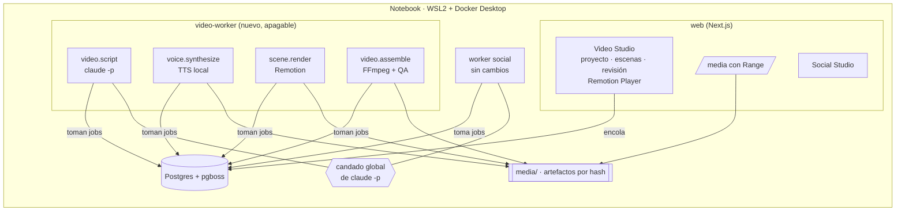

# RAdev Studio — Revisión de decisiones antes de V0 y V1

**Fecha:** 2026-11-20 · **Estado:** para revisar y aprobar con el operador. No autoriza implementar.
**Reemplaza** las secciones 2, 3.1, 5, 6 y 8 de `docs/RADEV-STUDIO-ANALISIS.md`. El resto de ese análisis sigue valiendo.
**Base:** `docs/RADEV-STUDIO-SPEC.md` v0.1, `docs/AUDIT.md`, el código de `packages/ai` y `apps/worker`, y una revisión **de solo lectura** de la notebook (memoria de Windows y de WSL, `.wslconfig`, `/etc/wsl.conf`, GPU, Docker).

---

## 1. Corrección de D-A: `claude -p` con la suscripción como proveedor principal

**Decisión del operador:** `claude -p` con la suscripción es el proveedor principal de IA de Social Studio **y** de Video Studio. No se reemplaza por la API de Anthropic. Los proveedores pagos quedan apagados, los modelos locales son una alternativa para tareas simples, y se diseña asumiendo que la suscripción **tiene límites**.

En mi análisis anterior lo había planteado al revés. Queda corregido.

### 1.1 Cómo está implementado hoy (`packages/ai/src/claude-code.ts`)

| Aspecto | Implementación actual |
|---|---|
| Binario | `@anthropic-ai/claude-code` **2.1.282** fijado en `packages/ai`, sin actualizaciones automáticas (`DISABLE_AUTOUPDATER=1`). Viaja con las dependencias del worker: cualquier app que use `@radev/ai` (también un `video-worker`) ya lo tiene. |
| Autenticación | `CLAUDE_CODE_OAUTH_TOKEN`, generado una vez con `claude setup-token`: es la misma suscripción, en forma de token para ejecución sin pantalla. **No** reusa la sesión interactiva de `~/.claude`, a propósito: `HOME` y `CLAUDE_CONFIG_DIR` apuntan a `/tmp/radev-social/claude-home`, así la generación no hereda tu `CLAUDE.md` personal, skills, plugins ni MCP. Con las dos credenciales definidas a la vez, el worker no arranca (regla 10). |
| Ejecución | `spawn` sin shell, en un workspace temporal fuera del repo; el prompt entra por stdin; `--json-schema` derivado de Zod; `--tools ""` (o la lista de la tarea); `--max-turns 3`; `--no-session-persistence`; `--setting-sources project`; `--strict-mcp-config`; prompt de sistema = instrucciones de la marca (modo liviano, ~1.000 tokens base). |
| Tiempo | 5 min por defecto (`timeoutMs`); al vencer, SIGTERM y a los 5 s SIGKILL. El `signal` de pg-boss corta igual. |
| Salida | Sobre JSON (o evento `result` de `stream-json` con imágenes): `structured_output` se vuelve a validar con Zod. |
| Registro | Por intento, en `generation_runs`: proveedor, modelo real (`modelUsage`), tokens de entrada (incluye los de caché), de salida, `total_cost_usd` (precio de lista: con la suscripción no se cobra), duración, turnos, `session_id`, estado y error. |
| Errores | 429 o el texto `usage limit reached\|<unix>` → `rate_limited` (con la hora de reinicio si viene); `max_turns`, timeout, 5xx o salida ilegible → reintentable; 401/403 → credencial, no reintentable; otros 4xx → no reintentable. |
| Límite alcanzado | `carousel.generate` reprograma con backoff de 15, 30, 60, 120 y después 240 min (o hasta la hora de reinicio informada), guarda `generation_retry_at`, avisa por Telegram y **se da por vencido a los 8 intentos** (~20 h). |
| Concurrencia | `batchSize: 1` en cada cola, pero **por cola**: hoy puede correr un `carousel.generate` y un `slide.rewrite` a la vez. No hay un candado global. |
| Respaldo | El router pasa a OpenRouter **automáticamente** ante `rate_limited` o `provider_error`. |

### 1.2 Qué podemos y qué no podemos saber de los límites

- **Sí**: cuándo se llega al límite (error de la corrida), a veces la hora de reinicio (en el texto), y lo que consume cada corrida (tokens, duración, turnos).
- **No**: cuánto cupo queda antes de llegar al límite. En modo `-p` el CLI no informa el uso restante de la suscripción (no encontré cómo; a verificar con la versión fijada). El cupo se estima con lo que registramos, no se consulta.
- **Sin verificar**: el formato exacto del límite. La detección del 429 y del texto está en el código, pero nunca se pudo provocar (ARCHITECTURE §7). Tampoco está medido cómo se comportan los límites semanales, si los hay en tu plan (a confirmar), además de la ventana de horas.
- **Compartido**: el mismo cupo lo usan tus sesiones de desarrollo con Claude Code (como esta). Producir video mientras desarrollás compite con vos.
- **Vencimiento del token**: el de `setup-token` dura mucho (a confirmar cuánto) pero no para siempre. Cuando vence llega un 401 → error no reintentable, sin aviso específico de "renová el token".

### 1.3 Qué propongo para gestionar límites, errores y recuperación

Casi todo se apoya en lo que ya existe. Lo nuevo es chico y no cambia el comportamiento de Social:

1. **Candado global de Claude**: un *advisory lock* de Postgres (`pg_try_advisory_lock`) alrededor de cada corrida de `claude -p`, compartido por el worker social y el `video-worker`. Garantiza **una sola corrida a la vez en todo el sistema**, que es lo que el comentario del código ya busca ("shares the subscription with the operator"). Si el candado está tomado, el job se reprograma unos segundos después sin contar como error.
2. **Política ante el límite por tarea**: `onLimit: "wait" | "fallback"`. Social mantiene su comportamiento actual (`fallback` a OpenRouter). Video usa `wait` por defecto: **pausa** y no baja de calidad sin avisar, como pide la especificación (§9). En V1 es una constante en código, sin tabla nueva.
3. **Pausa en vez de falla en Video**: ante `rate_limited`, el video no falla después de N intentos. Queda en pausa con `resume_at` (la hora de reinicio o el backoff), un aviso por Telegram y la reanudación automática. Todo lo producido queda guardado: cada tarea es un job separado y sus resultados están en la base (§4.4).
4. **Checkpoints = tareas chicas**: `claude -p` corre con `--no-session-persistence`. No se retoma una conversación a medias: se repite **la tarea** desde sus entradas guardadas (investigación, guion, una escena). Por eso el Director IA es una cadena de tareas cortas y no un prompt gigante.
5. **Estimación del cupo**: con `generation_runs` (tokens y corridas por ventana de 5 h y por día) se muestra "uso de Claude hoy" en el panel y se puede poner un tope propio de corridas automáticas por ventana, para dejarte margen para desarrollar.
6. **Ventana de generación**: la que ya existe para Social (`settings.generation_window`, de madrugada) se aplica también a las tareas automáticas de Video.
7. **Token vencido**: un 401 de `claude-code` genera el aviso "renová el token con `claude setup-token`" (una vez por día, como los de TikTok).

### 1.4 Riesgo que queda

Las condiciones de uso de la suscripción para ejecución automatizada son de Anthropic y pueden cambiar. **La decisión ya la tomaste**; lo dejo anotado solo para que el diseño mantenga la salida abierta: el router permite cambiar de proveedor por tarea desde el panel, sin código, si algún día hace falta.

---

## 2. Las once decisiones

**Columna "¿Cuándo?":** *Ahora* = hace falta para empezar V0 o para diseñar V1. *V0* = la decide el resultado de una prueba. *Después* = puede esperar sin costo.

| ID | Problema | Alternativas | Recomendación | Ventajas | Desventajas | Impacto en el MVP | ¿Cuándo? |
|---|---|---|---|---|---|---|---|
| **D-A** | Qué IA escribe guiones y planes sin costo extra | (a) `claude -p` con la suscripción como principal; (b) API de Anthropic; (c) solo modelos locales | **(a)**, con candado global, `onLimit: wait` en Video, pausa y reanudación (§1.3) | Ya existe y está probado en producción; buena calidad; costo cero | Cupo compartido con tu desarrollo; sin visibilidad del cupo restante; depende de las condiciones de Anthropic | Permite "Proponer guion con IA" ya en V1, reusando el router | **Ahora** (decidida por vos) |
| **D-B** | Si un video tiene que pertenecer a una marca | (a) obligatoria; (b) opcional sin más; (c) **opcional, con la identidad copiada al proyecto** | **(c)** (§3) | Temas genéricos sin crear una marca; reusa marcas cuando existen; el video no cambia si después editás la marca; ayuda a la caché | Hace falta una identidad por defecto para videos sin marca | Formulario: "Marca: ninguna / RAdev / Lumus..."; con "ninguna", estilo neutro | **Ahora** |
| **D-C** | Dónde se registra el consumo | (a) LLM en `generation_runs` + resto en `usage_events`; (b) todo en `usage_events`; (c) `provider_runs` nueva para todo | **(a)** | No duplica lo que ya registra Claude; una tabla chica para voz, render y FFmpeg | Dos tablas para un tablero de costos (se unen en una vista) | `generation_runs` suma `video_id`; `usage_events` nueva | **Ahora** (antes de la migración de V1) |
| **D-D** | Cómo cambiar una escena sin rehacer todo | (a) **una composición Remotion por escena + armado con FFmpeg**; (b) una composición única | **(a)**, principio desde V1 (§4) | Re-render solo de lo que cambió; el armado final tarda segundos; recuperación natural | Las transiciones entre escenas se limitan a entradas y salidas dentro de cada clip; hay que cuidar la sincronía del audio | Es la forma del pipeline de V1 | **Firmada el 2026-11-24** (V0-3): (a), con el audio armado aparte en PCM |
| **D-E** | Dónde vive Video Studio a futuro (notebook o servidor) | (a) solo la notebook, exportando los MP4; (b) `video-worker` en la notebook con túnel a la base de producción; (c) render en Oracle | Ninguna todavía | — | — | Ninguno: V0 y V1 son 100 % locales | **Después** (antes de V6) |
| **D-F** | Cómo modelar pausa, falla y espera | (a) estados de la máquina, como en la especificación; (b) **etapa en la máquina + condición aparte** | **(b)** (§4.4) | Pocas transiciones; "pausado en producción" y "falló al armar" se expresan sin estados nuevos; reanudar es volver a encolar lo pendiente | El estado visible se calcula (etapa + condición), no es una columna | Define la tabla `videos` y la máquina de V1 | **Ahora** |
| **D-G** | Qué voz local usar | (a) Kokoro; (b) Piper; (c) las dos; (d) un proveedor pago | Decidir con las muestras de V0-2 | Kokoro: liviano, licencia Apache 2.0 (a confirmar). Piper: muchas voces | Kokoro: pocas voces en español. Piper: licencia distinta por voz | Una interfaz `TtsProvider` con un proveedor en V1 | **V0** |
| **D-H** | Modelo local para tareas simples | (a) Ollama con un modelo de 7–8 B; (b) nada local en V1 | **(b) en V1**; probar Ollama en V0 solo para saber si sirve | No mete otra pieza en el MVP | Sin alternativa cuando Claude está en el límite (Video espera) | Ninguno si es (b) | **V0** (prueba opcional) |
| **D-I** | WSL ve 7,4 GB de RAM | (a) dejarlo así; (b) subir el límite con `.wslconfig` | **(b)**: 10 GB + 8 GB de swap (§5) | Margen para Remotion, Chrome, Next y Docker juntos | Windows queda con ~5 GB cuando WSL está a pleno; hay que reiniciar WSL (apaga Docker) | Necesario para medir V0 sin quedarnos cortos | **Ahora** (antes de V0) |
| **D-J** | Personajes 2D sin problemas de licencia | (a) **muñeco propio en SVG**; (b) packs de terceros (Lottie, Rive); (c) generados con IA | **(a)** en V1 | Sin licencias; consistente por definición; usa la paleta de la proyección | Más simple que un personaje ilustrado profesional | Un tipo de escena `character` | **Ahora** (para diseñarlo en V0-6) |
| **D-K** | Cuándo hacer commit de estos documentos | (a) ahora, solo docs; (b) junto con los ADR al cerrar V0 | **(a)**: un commit `docs:` con la especificación, la auditoría, el análisis y esta revisión, cuando apruebes | Queda versionado y se ve desde la otra máquina | Ninguna real | Ninguno | **Ahora** |

---

## 3. D-B en detalle: relación entre videos y marcas

**Lo que tiene una marca hoy:** preset de estilo y tokens (colores, tipografías, logo), documentos (voz, reglas, precios, casos), pilares, zona horaria, topes de IA y cuentas sociales. Es justo lo que un video "de RAdev" o "de Lumus" necesita.

**Lo que molesta de hacerla obligatoria:** un video de curiosidades o de historia obligaría a crear una marca nueva, que **aparece en Social Studio** (selector, calendario, métricas) y pide prefijo, preset y tokens. No es grave (las marcas sin horarios no generan carruseles), pero ensucia y es una restricción sin beneficio.

**Propuesta (c): marca opcional + identidad del proyecto.**
- `videos.brand_id` **puede ser nulo**.
- Al crear el video se arma su **identidad de producción** y se guarda en el proyecto: estilo visual (preset y tokens), idioma, voz, zona horaria y, si hay marca, una referencia a la versión de los documentos que usó.
  - **Con marca**: se copia de la marca.
  - **Sin marca**: un estilo neutro (los tokens por defecto del preset, que son código como los presets: regla 6) y la zona horaria del operador (un ajuste global).
- **Por qué copiar y no leer en vivo**: el video tiene que poder rehacerse igual. Si cambiás el acento de RAdev la semana que viene, un video aprobado no cambia solo, y la caché por hash no se invalida por algo que no tocaste. Un botón "Actualizar desde la marca" lo trae a propósito.
- **IA**: con marca, el prompt de sistema es el de hoy (`brand-instructions.ts`); sin marca, un prompt genérico del Director más lo que escribas en el proyecto.
- **Topes**: con marca, cuentan para los de la marca; sin marca, para un tope global de Video.

**Impacto en el MVP**: un selector "Marca (opcional)" y una función `resolveVideoIdentity`. Nada cambia en `brands` ni en Social.

---

## 4. Arquitectura actualizada

### 4.1 Diagrama (V1, todo en la notebook)



### 4.2 Principios (aprobados o propuestos)

1. **Render por escena** (D-D): cada escena es un clip independiente; el video final siempre se arma con FFmpeg.
2. **Caché por hash**: todo recurso generado tiene una clave reproducible; si la clave ya existe, no se genera (§4.3).
3. **La especificación del video es autosuficiente**: todo lo que influye en el resultado está en el proyecto (identidad copiada, guion, escenas, parámetros), no en lecturas en vivo.
4. **Etapa + condición** (D-F, §4.4).
5. **Un `claude -p` a la vez en todo el sistema** (§1.3).
6. **Proveedores pagos apagados**: no hay ninguno en V1, así que se cumple por construcción.

### 4.3 Caché por hash

**Clave** = `sha256(JSON canónico de las entradas)`, con las claves del objeto ordenadas y sin ids, fechas ni nombres de archivo.

| Artefacto | Entra en la clave |
|---|---|
| Guion o plan (IA) | Tarea, proveedor, modelo pedido, versión del prompt y de la guía, entradas (tema, identidad, recursos por su clave), schema (versión) |
| Voz de una escena | Proveedor, modelo y su versión, voz, idioma, texto normalizado, parámetros (velocidad, tono) |
| Imagen generada (V4+) | Proveedor, modelo y versión, prompt final, parámetros, semilla o `variant`, referencias visuales (por su clave) |
| Recurso subido | `sha256` de los bytes (así el mismo archivo subido dos veces es uno) |
| Clip de escena | Tipo de escena y su `TEMPLATE_VERSION`, datos de la escena, claves de su voz y de sus recursos, identidad visual (hash de los tokens), formato (tamaño, fps, códec) |
| Pista de audio | Claves de las voces en orden, música (clave), parámetros de mezcla y de normalización |
| Video final | Claves de los clips en orden, clave de la pista de audio, parámetros de armado |

**Reglas:**
- **Generadores no deterministas** (IA): "Regenerar" no borra nada: suma 1 a `variant`, que entra en la clave. La versión anterior sigue en la caché y se puede volver a ella.
- **`TEMPLATE_VERSION`**: una constante por tipo de escena en `packages/video`. Se sube a mano cuando cambia el dibujo de esa plantilla. Así un cambio en la plantilla `list` invalida solo los clips `list`, y no todo (un hash del bundle entero invalidaría todo con cualquier cambio).
- **Tabla de artefactos**: `kind`, `key` (única), `path`, metadatos (duración, tamaño), `created_at`. Un job empieza buscando su clave: si existe y el archivo está, termina sin hacer nada. Es la idempotencia de la regla 8.
- **Limpieza**: los artefactos que no usa ninguna versión vigente ni aprobada se borran a los N días (job diario). Las voces y lo subido por vos no se borran solos.

### 4.4 Estados de producción (D-F)

**Etapa** (máquina de estados en `core/videos`, la única forma de cambiarla):

```
draft → [researching] → scripting → script_review → [storyboarding → storyboard_review]
      → producing → assembling → in_review → approved → [scheduled → publishing → published]
cualquiera (salvo published) → archived
```
- Entre corchetes: etapas que existen en la máquina desde V1 pero que V1 no recorre (investigación, storyboard y publicación llegan en V2 y V6).
- Respecto de la especificación: `composing` y `rendering` se reemplazan por `producing` (voz, recursos y clips de cada escena) y `assembling` (armado con FFmpeg y control de calidad). Con render por escena, "componer" y "renderizar" no son pasos separados. `paused` y `failed` salen de la máquina.
- **Vuelven atrás**: rechazar el guion (→ `scripting`), editar escenas en revisión (→ `producing`, solo lo `stale`), rechazar el video (→ `scripting` o `producing` según la nota), y cualquier edición después de `approved` (invalida la aprobación).

**Condición** (columnas aparte, no transiciones):

| Campo | Para qué |
|---|---|
| `paused_at`, `pause_reason` (`operator`, `provider_limit`, `budget`, `window`) | Pausado. Con `provider_limit`, también `resume_at`. |
| `failure` (jsonb: etapa, tarea, error, reintentable, fecha) | La última falla. No cambia la etapa ni borra nada. |
| Estado de cada escena y artefacto: `pending`, `running`, `ready`, `stale`, `failed` | Progreso fino. `producing` termina cuando todas las escenas están `ready`. |

**Estado visible** (una función pura, `videoDisplayStatus`): etapa + condición + escenas →

| Se ve | Cuándo |
|---|---|
| En producción | Etapa de trabajo, sin pausa ni falla |
| Pausado (motivo y hasta cuándo) | `paused_at` presente |
| Falló (qué y por qué) | `failure` presente y sin reintentos automáticos pendientes |
| Esperando tu revisión | `script_review`, `storyboard_review` o `in_review` |
| Esperando intervención | Falla no reintentable, o pausa por `operator` o `budget` |
| Aprobado, publicado, archivado | Esas etapas |

**Reglas:** mientras hay pausa, ningún job avanza la etapa (cada job lo revisa al empezar). "Reanudar" borra la pausa y vuelve a encolar las tareas `pending` o `stale` de la etapa actual; las `ready` no se tocan. "Reintentar" hace lo mismo después de una falla. **Tests de invariantes**: no hay voz definitiva sin guion aprobado; no se publica sin el video aprobado; editar después de aprobar invalida la aprobación; una falla no borra resultados; una pausa no avanza la etapa.

### 4.5 D-D en detalle: render por escena desde V1, sin un editor complejo

**Pipeline:**
1. **Guion guardado** = una versión de `video_scripts` (JSON validado con Zod) con sus escenas en orden.
2. **Diferencia por claves**: al guardar una versión nueva, se calculan las claves de cada escena. Las que ya existen en la caché quedan `ready`; las demás, `pending`.
3. **Voz por escena** (`voice.synthesize`): un WAV por escena, rellenado o recortado a una **cantidad exacta de cuadros** (duración en cuadros = redondeo hacia arriba de `ms × fps / 1000` + un margen fijo).
4. **Clip por escena** (`scene.render`): una composición Remotion por tipo de escena, que recibe los datos de la escena como props. Todas con **los mismos parámetros de salida** (1080×1920, 30 fps, H.264, mismo formato de píxel y GOP), **sin audio**.
5. **Armado** (`video.assemble`):
   - Video: concat de los clips con el demuxer `concat` de FFmpeg y `-c copy` (sin re-codificar: segundos).
   - Audio: los WAV en orden (con precisión de muestra), más la música con *ducking* y la normalización de volumen, en una sola pasada a AAC.
   - Mux de video y audio + QA (duración, cuadros negros, volumen) + miniatura.
   - **Por qué el audio va aparte**: concatenar clips que ya traen AAC deja pequeños cortes o desfasajes en cada unión (por el relleno del códec). Armar el audio una vez en PCM los evita. V0-3 compara las dos formas.
6. **Transiciones**: en V1, corte directo más las animaciones de entrada y salida de cada plantilla. Los fundidos entre escenas, si hacen falta, después (un clip corto de transición con su propia clave).

**"Editor" de V1** (sin línea de tiempo):
- Lista de escenas: texto narrado, tipo de plantilla, campos de la plantilla, recurso (opcional). Es un formulario, como el editor de carruseles.
- Cada escena muestra su estado (`ready`, `pending`, `stale`, `failed`) y un botón "Rehacer escena" (suma 1 a `variant`).
- Guardar crea una versión del guion. Solo se encolan las escenas cuyas claves cambiaron, y después el armado.
- Vista previa con Remotion Player (en el navegador, sin render) y el MP4 real cuando está.
- Reordenar escenas no re-renderiza ningún clip: solo cambia el armado.

---

## 5. D-I en detalle: configuración de WSL

### 5.1 Configuración actual (verificada, solo lectura)

| Dato | Valor |
|---|---|
| RAM física (Windows) | 15,2 GB; **5,2 GB libres** en el momento de la medición |
| Procesos grandes en Windows | Compresión de memoria ~1 GB, varias ventanas de Chrome ~1,2 GB, Claude ~0,4 GB, Snipping Tool, Epic Games Launcher, Defender y Discord ~0,25–0,3 GB cada uno |
| `C:\Users\rekoa\.wslconfig` | **No existe**: WSL usa los valores por defecto |
| Memoria de WSL | **7,4 GB** (la mitad de la RAM, por defecto), con 0,85 GB en uso y Postgres en 41 MB |
| Swap de WSL | 2 GB, sin uso |
| Archivo de paginación de Windows | 20 GB, casi sin uso |
| Versión | WSL 2.6.3.0, kernel 6.6.87.2 |
| Distros | `Ubuntu-24.04` y `docker-desktop`, las dos en **la misma VM**: el límite de WSL incluye a los contenedores de Docker |
| GPU en WSL | RTX 4050, 6.141 MiB, driver 610.88 (`nvidia-smi` responde) |
| Disco de WSL | 1 TB virtual, 25 GB usados |
| `/etc/wsl.conf` de Ubuntu | **Mal formado**: `generateResolvConf = false[boot]` (falta un salto de línea antes de `[boot]`). Por eso **systemd no arranca** (PID 1 es `init`), aunque el archivo dice `systemd=true` |

### 5.2 Cómo afecta a Windows

- WSL **no reserva** la memoria: la toma a medida que la usa, hasta el límite. Con el límite en 10 GB, Windows no pierde nada mientras WSL esté tranquilo.
- El problema es el pico: si WSL llega a 10 GB, a Windows le quedan ~5 GB para Chrome, Discord, el launcher de Epic, Defender y el sistema. Hoy esos procesos ya suman unos 4–5 GB. Windows va a usar el archivo de paginación (en NVMe: lento pero aguanta).
- WSL tarda en **devolver** la memoria que usó como caché de disco. La opción `autoMemoryReclaim` hace que la devuelva sola.

### 5.3 Consumo esperado de una sesión de V1

Estimación (se mide en V0):

| Componente (dentro de WSL) | Pico aproximado |
|---|---|
| Docker Desktop (VM, servicios) + Postgres | 0,6–0,8 GB |
| `next dev` (web) | 1–1,5 GB |
| worker social (+ Chromium si renderizó un carrusel) | 0,3–0,7 GB |
| `video-worker`: Node + bundle de Remotion | 0,8–1,2 GB |
| Chrome de Remotion, con concurrency 4 | 1–1,6 GB |
| TTS local | 0,5–1 GB |
| `claude -p` | 0,3–0,4 GB |
| Caché de disco del kernel | variable |
| **Total** | **~5–7,2 GB** |

Con el límite actual de 7,4 GB se llega justo, y cuando se pasa el kernel de WSL mata procesos (lo más probable: Chrome de Remotion o `next dev`).

### 5.4 Propuesta (no aplicada)

```ini
# C:\Users\rekoa\.wslconfig
[wsl2]
memory=10GB          # tope de la VM (Ubuntu + Docker); Windows conserva ~5 GB
swap=8GB             # colchón antes de que el kernel mate procesos
# processors: sin definir = los 16 hilos (WSL ya los usa todos)

[experimental]
autoMemoryReclaim=gradual   # devuelve a Windows la memoria que deja de usar
```

- **Por qué 10 y no 11 GB**: con Chrome, Discord y Epic abiertos, Windows ya usa 4–5 GB. 11 GB lo deja muy justo; 10 es un término medio. Si en V0 vemos que WSL no pasa de 8, se puede bajar.
- **A verificar antes de aplicarlo**: en qué sección va `autoMemoryReclaim` en WSL 2.6 (en versiones anteriores estaba en `[experimental]`) y su compatibilidad con Docker Desktop. Si da problemas, `dropCache` es la variante conservadora, o se saca.
- **Cómo se aplica**: crear el archivo y ejecutar `wsl --shutdown`. Eso **apaga Ubuntu y Docker Desktop** (y corta cualquier `pnpm dev` o contenedor en marcha); al abrir de nuevo la terminal o Docker, todo vuelve. No toca datos: el volumen de Postgres y `media/` quedan como están.
- **Cómo se revierte**: borrar el archivo y `wsl --shutdown` otra vez.
- **Buenas prácticas para las sesiones de render**: cerrar el launcher de Epic y las pestañas que no uses; Remotion con concurrency 2–4 (no la de por defecto, que usa la mitad de los hilos).

### 5.5 `/etc/wsl.conf` (decisión aparte, D-I-2)

Arreglar el salto de línea haría que **systemd empiece a arrancar** en Ubuntu. Es probablemente lo que se quiso en su momento, pero cambia cómo arranca la distro, y el entorno funciona hoy sin systemd (Docker corre en su propia distro). Propuesta: **no tocarlo por ahora**. Si se arregla, que sea en un momento aparte y probando que Docker, `pnpm dev` y el Postgres nativo de WSL (el del puerto 5432, de otros proyectos) sigan andando. Además, `generateResolvConf` hoy no se está leyendo bien: a revisar en el mismo momento.

---

## 6. Pruebas de V0

**Reglas para todas:** se hacen en una rama `spike/video-v0` (o en carpetas `.scratch/`, ignoradas por git), son descartables y no tocan `main`, la base de producción ni el servidor. Cada una deja sus números en un informe (`docs/V0-RESULTS.md`, que se commitea al cerrar V0).

**Prerrequisito V0-0**: aplicar el `.wslconfig` (si lo aprobás), anotar la línea base (memoria libre en Windows y en WSL, temperaturas en reposo) y dejar instalado `ffmpeg` en Ubuntu (`apt`, con tu OK, porque es instalar un paquete del sistema).

### V0-1 · Remotion en el entorno local
- **Objetivo**: saber si Remotion renderiza Shorts en la notebook en tiempos razonables, y con cuánta memoria.
- **Herramientas**: Remotion (`@remotion/renderer`, `@remotion/bundler`, `@remotion/player`), Node 24 en WSL, el Chrome headless que trae Remotion.
- **Procedimiento**: una composición de 30 s a 1080×1920 y 30 fps con 5–6 escenas de motion graphics (título animado, lista, número grande, cita, cierre) y tipografías del repo. Render con concurrency 2, 4 y 6, tres veces cada uno, más una corrida con la web y el worker levantados al mismo tiempo.
- **Qué medir**: segundos de render por segundo de video, CPU, RAM pico (WSL y Windows), temperatura, tamaño del MP4, tiempo de bundle (en frío y con caché) y si el Player anda en el panel.
- **Éxito**: un Short de 45 s en **≤ 3 min** con concurrency 4, sin que WSL pase de 8 GB ni la notebook se ponga inestable.
- **Decide**: Remotion como motor (D-D), la concurrency por defecto y si el `.wslconfig` alcanza.

### V0-2 · Kokoro y Piper
- **Objetivo**: elegir una voz local por idioma, con licencia que permita uso comercial y con tiempos para los subtítulos.
- **Herramientas**: Kokoro (paquete de Python o JS, a elegir el más simple), Piper (binario), `whisper.cpp` o `faster-whisper` solo si hace falta alinear.
- **Procedimiento**: el mismo texto de ~40 s (con números, nombres propios y una pregunta) en español y en inglés, con 2–3 voces de cada motor. Ver si devuelven tiempos por palabra; si no, alinear con whisper. Anotar la licencia de cada voz y de cada modelo.
- **Qué medir**: velocidad (segundos de audio por segundo de proceso, en CPU), RAM, calidad (la juzgás vos de oído, de 1 a 5), precisión de los tiempos (subtítulos desfasados > 100 ms se notan) y la licencia.
- **Éxito**: al menos una voz por idioma con nota ≥ 3, más rápida que el tiempo real en CPU, con licencia comercial y subtítulos sincronizados.
- **Decide**: D-G (proveedor TTS de V1) y si hace falta un paso de alineación. Si ninguna voz llega a 3, se reabre la discusión de un proveedor pago con tope, con tu aprobación.

### V0-3 · Render por escena + FFmpeg
- **Objetivo**: confirmar que el pipeline de §4.5 funciona sin cortes y que rehacer una escena es barato.
- **Herramientas**: las escenas de V0-1 y la voz de V0-2; FFmpeg y ffprobe del sistema.
- **Procedimiento**: cada escena como clip propio, sin audio, con parámetros idénticos; voces en WAV ajustadas a cuadros exactos; concat con `-c copy`; audio armado en PCM + música con *ducking* + normalización; mux. Comparar contra la variante de clips con audio incluido. Después, cambiar el texto de una escena y rehacer solo esa más el armado.
- **Qué medir**: cortes audibles o saltos de cuadro en las uniones (escuchar y mirar, más `ffprobe` de los timestamps), desfase de audio al final, tiempo del armado y del re-render parcial contra el completo, volumen final.
- **Éxito**: sin cortes ni saltos perceptibles, desfase final menor a 1 cuadro, armado en **< 15 s** y re-render de una escena en una fracción del total.
- **Decide**: D-D en firme y la variante de audio (aparte o incluido).

### V0-4 · Ollama (opcional)
- **Objetivo**: saber si un modelo local sirve para tareas simples (reescribir una escena, títulos, subtítulos alternativos) cuando Claude está en el límite.
- **Herramientas**: Ollama para Windows o Linux con GPU; 2 modelos de 7–8 B cuantizados (a elegir en el momento, con licencia que permita uso comercial).
- **Procedimiento**: 20 pedidos de "reescribí esta escena" y 10 de "guion de 6 escenas", con el mismo JSON Schema de Zod que usaría `claude -p`; lo mismo con `claude -p` como referencia.
- **Qué medir**: % de respuestas que pasan Zod, tokens por segundo, VRAM, calidad en español (la juzgás vos) contra Claude.
- **Éxito**: ≥ 90 % pasa Zod en las tareas simples con calidad aceptable para vos.
- **Decide**: D-H, y si vale sumar el proveedor `ollama` en V2.

### V0-5 · Reuso de los estilos de `packages/slides`
- **Objetivo**: saber si los looks de `studio`, las fuentes y los íconos se pueden usar dentro de Remotion sin duplicar código.
- **Herramientas**: el bundle de Remotion importando `@radev/slides`.
- **Procedimiento**: renderizar en Remotion una escena con un look de `studio` (tokens de RAdev), `SlideFrame` y una fuente del registro, adaptada a 9:16. Anotar todo lo que no compile o no se vea igual (dependencias de Next, del DOM de `/render`, de las CSS de Tailwind, de la carga de fuentes, del tamaño fijo 4:5).
- **Qué medir**: si compila, si se ve igual que en el carrusel y qué hay que cambiar en `slides` (y si esos cambios pueden romper el render de carruseles).
- **Éxito**: un look renderizado en Remotion sin cambios en `slides`, o con cambios chicos que no afectan a Social.
- **Decide**: si las escenas de V1 reusan los looks (más identidad de marca) o arrancan con plantillas propias (más simple). En los dos casos, Social no se toca.

### V0-6 · Personaje 2D propio en SVG
- **Objetivo**: ver si un muñeco simple, hecho por nosotros, alcanza la calidad que querés para V1.
- **Herramientas**: React + SVG dentro de Remotion; `@remotion/media-utils` para la amplitud del audio.
- **Procedimiento**: un personaje con cabeza, ojos, boca y brazos; 3–4 poses (neutral, señala, piensa, celebra); parpadeo; boca que se abre con la amplitud de la voz de V0-2; colores desde los tokens de la identidad. Una escena de 8 s hablando.
- **Qué medir**: cómo se ve (vos decidís), cuánto suma al tiempo de render y qué tan fácil es cambiar colores y poses desde datos.
- **Éxito**: lo aprobás como "aceptable para un Short" y se maneja solo con datos (sin editar el SVG a mano por video).
- **Decide**: D-J en firme y el alcance del tipo de escena `character` de V1.

### V0-7 · Licencias y condiciones
- **Objetivo**: no meter nada que después no se pueda usar comercialmente.
- **Herramientas**: las páginas oficiales de cada proyecto (lectura, sin cuentas nuevas).
- **Procedimiento**: una tabla con el nombre, la versión, la licencia, si permite uso comercial, si pide atribución, el enlace y la fecha de consulta, para Remotion (licencia propia: gratis hasta cierto tamaño de empresa), Kokoro (modelo y voces), Piper (motor y **cada voz** elegida), whisper, los modelos de Ollama que se prueben, FFmpeg (LGPL o GPL según la compilación de Debian: importa si alguna vez se distribuye), las fuentes del repo ya revisadas y la fuente de música.
- **Éxito**: todo lo que entra en V1 tiene licencia compatible y anotada.
- **Decide**: qué herramientas entran a V1, y si hace falta algo de la licencia de Remotion.

### V0-8 · `claude -p` para tareas de video (agregada)
- **Objetivo**: saber cuánto cupo consume un guion y si el formato de salida alcanza.
- **Herramientas**: el proveedor `claude-code` actual, con el smoke de `packages/ai` (`pnpm --filter @radev/ai smoke`) o un script en `.scratch/`.
- **Procedimiento**: 5 guiones de 6–8 escenas sobre temas distintos (uno técnico, uno de historia, uno de curiosidades) con un schema Zod de prueba; 5 reescrituras de una escena.
- **Qué medir**: tokens de entrada y salida, turnos, duración y % que pasa Zod.
- **Éxito**: un guion en < 60 s y < 15.000 tokens, ≥ 90 % válido al primer intento.
- **Decide**: si V1 incluye "Proponer guion con IA" y cuánto cupo reservar para Video.

### Cambios del 2026-11-24 (después de V0-5 y V0-6)

- **V0-5:** técnicamente viable, pero descartada como base del video: el video no son slides.
- **V0-6, redefinida:** video animado guionado escena por escena. Estilo aprobado por el operador; voz a 1,3.
- **Pruebas nuevas y ampliadas** (detalle en `docs/RADEV-STUDIO-CANALES-Y-FORMATOS.md` §7):
  - **V0-8** también mide un guion en el formato de V0-6 y un plan de capítulos de 4 min.
  - **V0-9, nueva:** render de un video 16:9 de 5 min.
  - **V0-10, nueva:** costo de sumar dibujos (incluye uno de "Educación").
  - **V0-7** suma la API de YouTube y el cupo de ElevenLabs.
- **Videos largos:** de 3 a 5 minutos, nunca 10. Pasan a V2 junto con la publicación en YouTube.
- **El alcance de §7 se reescribe cuando terminen estas pruebas.**

**Criterio de "terminado" de V0**: el informe con los números de V0-1 a V0-8, las decisiones D-D, D-G, D-H y D-J firmadas y los ADR escritos: Video Studio en el alcance del PRD, render por escena y caché por hash, voz local, y `claude -p` para Social y Video.

---

## 7. Alcance definitivo de V1

**Objetivo**: desde el panel, en la notebook, producir un Short de 30–45 s (9:16) de **cualquier tema**, en español o en inglés, con o sin marca, verlo, aprobarlo y descargar el MP4. Costo cero.

**Dentro:**
- Proyecto de video: tema, idioma, marca opcional (identidad copiada), duración objetivo.
- Guion por escenas: lo escribís vos en un formulario o lo propone `claude -p` (`video.script`, si V0-8 sale bien), validado por Zod. Primera puerta: aprobar el guion.
- 6–8 tipos de escena: título animado, afirmación, lista, número grande (cifras dadas por vos, regla 9), cita, personaje (el SVG de V0-6), imagen (un recurso propio subido) y cierre.
- Voz local por escena (el TTS de V0-2) con caché por hash, y subtítulos palabra por palabra dentro de la zona segura de Shorts.
- Render por escena (Remotion) + armado (FFmpeg: concat, música opcional con *ducking*, normalización, miniatura) + QA del video.
- Etapas y condiciones de §4.4, con pausa y reanudación si `claude -p` llega al límite.
- Revisión: Remotion Player + MP4 real, aprobar, rechazar con nota, editar escenas (solo se rehace lo que cambió) y "Rehacer escena". Segunda puerta: aprobar el video.
- Descarga del MP4.
- Registro: `generation_runs` (Claude) y `usage_events` (voz, render, armado: tiempo, CPU, RAM pico, tamaño; costo 0).
- `/media` con streaming y `Range` (audio y video), detrás de la sesión.

**Fuera de V1:** investigación con fuentes y modo automático (V2), storyboard con imágenes (V2), editor con línea de tiempo y personajes persistentes generados (V3), Blender, ComfyUI e imágenes locales (V4), video con IA y proveedores pagos (V5), YouTube y analytics (V6), formato horizontal y videos largos (V2 y V7), música generada, Ollama como proveedor (V2 si V0-4 sale bien).

**Tareas de V1:**

| # | Tarea | Hecho cuando |
|---|---|---|
| T1 | Docs y ADR: PRD (video en el alcance), ARCHITECTURE (sección Video), ROADMAP, CLAUDE.md (comandos del `video-worker`) | Revisados por vos |
| T2 | `packages/video`: schemas de guion, escenas, identidad y `VideoSpec`; `TEMPLATE_VERSION`; claves de hash (JSON canónico + sha256) | Tests de schemas y de claves (misma entrada → misma clave; cualquier cambio relevante → clave distinta) |
| T3 | `core/videos`: etapas, transiciones, condición, `videoDisplayStatus`, reglas de invalidación | Tests de invariantes de §4.4 |
| T4 | `db`: migración solo aditiva: `videos`, `video_scripts`, `video_scenes`, `video_artifacts` (por clave), `media_items` (con origen y licencia), `usage_events`; `generation_runs.video_id` y la tarea `video.script` en los CHECK | Aplicada en local; Social sin cambios (sus tests en verde) |
| T5 | `/media` con streaming y `Range`; escritura por streaming; subida de recursos por Route Handler | Un MP4 de 200 MB se reproduce y se adelanta sin cargar la memoria de la web |
| T6 | `apps/video-worker`: arranque, logger, apagado, colas; candado global de `claude -p` (también en el worker social: es el único cambio en Social, y no cambia su comportamiento) | Los dos workers nunca corren `claude -p` a la vez |
| T7 | TTS: `TtsProvider` en `packages/ai/src/tts/` con el proveedor elegido, caché, alineación si hace falta | Tests de la caché y de los errores |
| T8 | Composiciones Remotion: los tipos de escena, subtítulos, zona segura, identidad visual, personaje | Revisión visual con capturas (como DESIGN-SYSTEM §10) |
| T9 | `scene.render` y `video.assemble` con caché, QA y medición | Repetir un job no rehace nada; cambiar una escena rehace solo esa y el armado |
| T10 | Panel → Video: listado por estado visible, nuevo proyecto, editor de escenas (formulario), aprobar guion, progreso por escena, Player, revisión, descarga | Usable también desde el celular para revisar |
| T11 | Pausa y reanudación ante el límite de Claude; aviso por Telegram | Probado simulando un `rate_limited` en un test |
| T12 | Docker: destino `video-worker` (ffmpeg + Chrome de Remotion) y perfil `video` en Compose, sin tocar los servicios actuales | `docker compose up -d` sigue igual; `--profile video` suma el worker |
| T13 | Punta a punta y `PROGRESS.md` | Criterio de abajo |

**Criterio de aceptación de V1:**
1. Dos Shorts de 30–45 s, uno en español y otro en inglés, de dos temas que no tengan nada que ver entre sí (por ejemplo, "cómo funciona la IA" y un tema de historia), uno con marca y otro sin marca.
2. Los dos producidos desde el panel en la notebook, aprobados por vos como "calidad aceptable" y descargados en MP4.
3. Cambiar el texto de una escena rehace **solo** su voz, su clip y el armado; reordenar escenas rehace solo el armado.
4. Un límite de Claude durante `video.script` pausa el video, avisa y retoma solo, sin perder nada.
5. Social Studio sigue igual: tests en verde y un carrusel generado y renderizado de punta a punta en local.

---

## 8. Riesgos y limitaciones

| Riesgo | Probabilidad | Impacto | Mitigación |
|---|---|---|---|
| El cupo de Claude no alcanza para Social + Video + tu desarrollo | Media | Alto | Candado global, ventana nocturna, `onLimit: wait`, tope propio por ventana, guion manual siempre disponible |
| Formato del límite de Claude distinto al esperado (nunca se pudo provocar) | Media | Medio | Clasificación por 429 o por texto, más un caso "salida ilegible" reintentable; revisar los logs la primera vez que pase |
| Cambio en las condiciones de uso de la suscripción | Baja–media | Alto | El router permite cambiar el proveedor por tarea sin código |
| Voz local de calidad insuficiente en español | Media | Alto | V0-2 antes de diseñar; si falla, decisión explícita sobre un pago con tope |
| RAM de la notebook (WSL hoy en 7,4 GB) | Alta sin el cambio | Medio | `.wslconfig` (D-I), concurrency baja, cerrar procesos pesados en las sesiones de render |
| Cortes en las uniones del concat | Media | Medio | Audio armado aparte en PCM, cuadros exactos, V0-3 |
| `packages/slides` atado a Next o al 4:5 | Media | Bajo | V0-5; plan B: plantillas propias de video |
| Temperatura de la notebook en renders largos | Media | Bajo en V1 (Shorts) | Medir en V0-1; concurrency moderada |
| Licencias de voces y modelos | Media | Alto | V0-7 antes de usar cualquier cosa en V1 |
| El cambio de `/media` (código compartido) rompe cómo se sirven las imágenes | Baja | Alto | Tests de las imágenes actuales antes y después; los videos van por una rama nueva del handler |
| Crecimiento del alcance | Alta | Alto | V1 cerrado en §7; todo lo demás, a su fase |
| `/etc/wsl.conf` mal formado | Ya pasa | Bajo | Anotado (D-I-2); no se toca sin una decisión aparte |

**Limitaciones conocidas de V1**: solo 9:16 y 30–45 s; transiciones de corte o de entrada y salida; personajes simples; sin investigación automática (los hechos los ponés vos o salen del guion de Claude, que revisás en la primera puerta); sin publicación.

---

## 9. Lo que necesito que apruebes

**Para empezar V0:**
1. **D-A**: `claude -p` con la suscripción como principal en los dos módulos, con candado global, `onLimit: wait` en Video y pausa con reanudación (§1.3). *(Ya lo decidiste: confirmo las piezas nuevas.)*
2. **D-I**: crear `C:\Users\rekoa\.wslconfig` con la configuración de §5.4 y reiniciar WSL (apaga Docker un momento). **Y** dejar `/etc/wsl.conf` como está por ahora (D-I-2).
3. **V0-0**: instalar `ffmpeg` en Ubuntu con `apt`.
4. **Pruebas V0-1 a V0-8** en la rama `spike/video-v0`, con el informe al final.
5. **D-K**: commit `docs:` con la especificación, la auditoría, el plan de evolución, el análisis y esta revisión.

**Para diseñar V1 (pueden aprobarse ahora o al cerrar V0):**
6. **D-B**: marca opcional con identidad copiada al proyecto (§3).
7. **D-C**: `generation_runs` para la IA y `usage_events` para el resto.
8. **D-D**: render por escena + armado con FFmpeg + caché por hash como principios (§4.3 y §4.5).
9. **D-F**: etapa en la máquina de estados + condición aparte (§4.4), con el cambio de `composing`/`rendering` a `producing`/`assembling`.
10. **D-J**: personaje propio en SVG.
11. **Alcance de V1** de §7 y su criterio de aceptación.

**Las decide V0:** D-G (voz), D-H (Ollama). **Pueden esperar:** D-E (topología, antes de V6).
